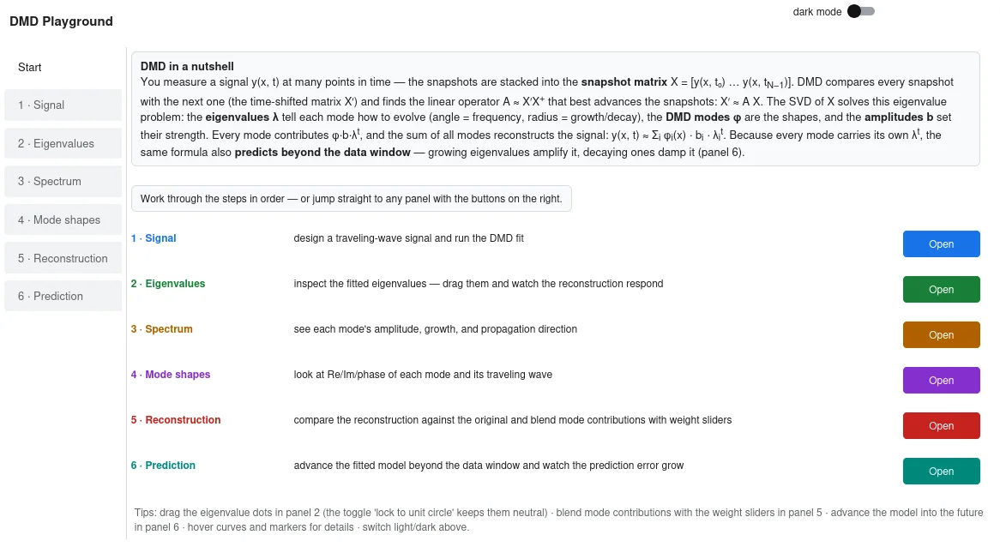
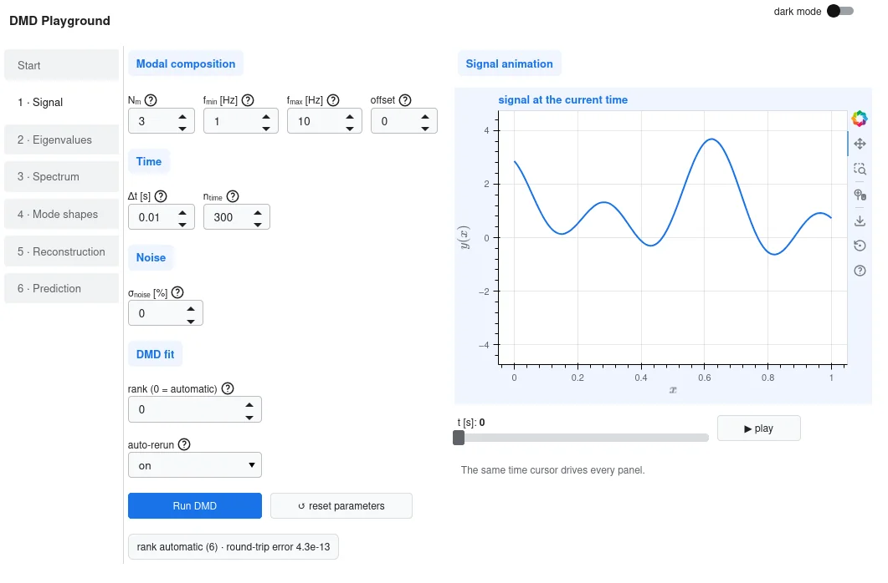
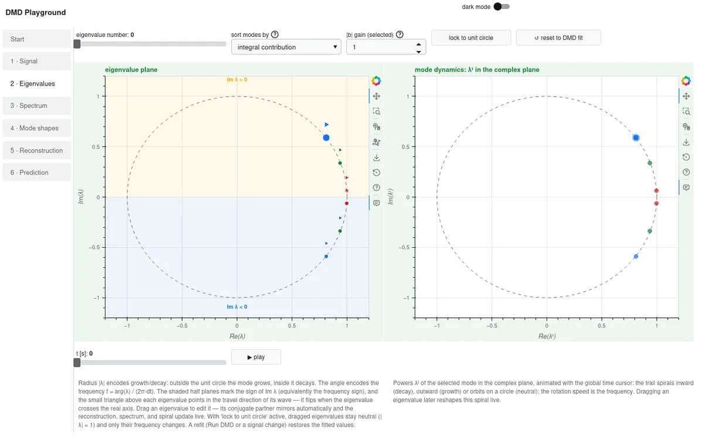
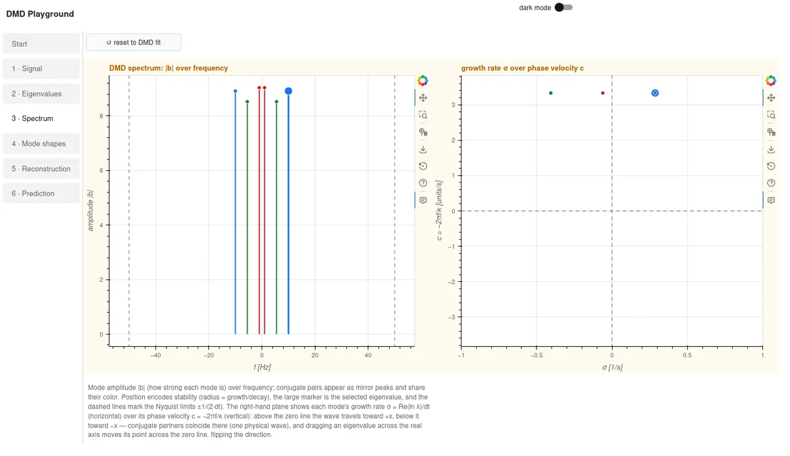
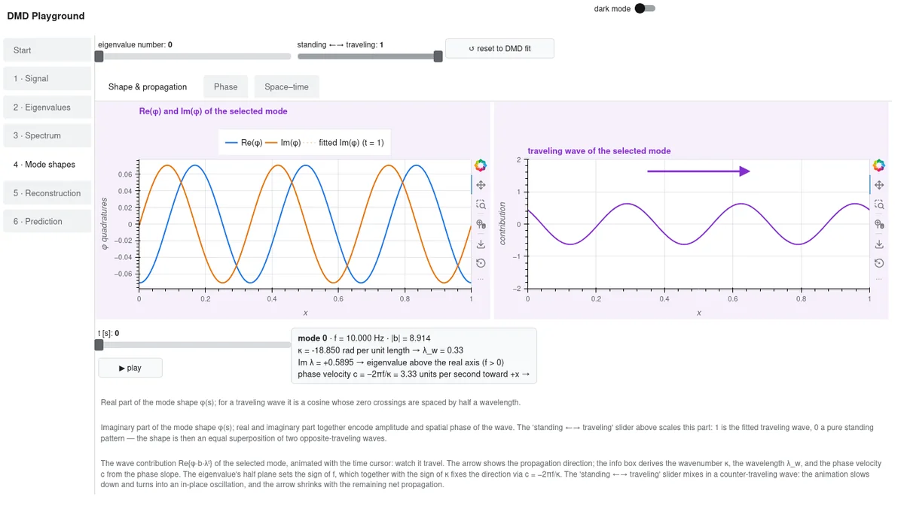
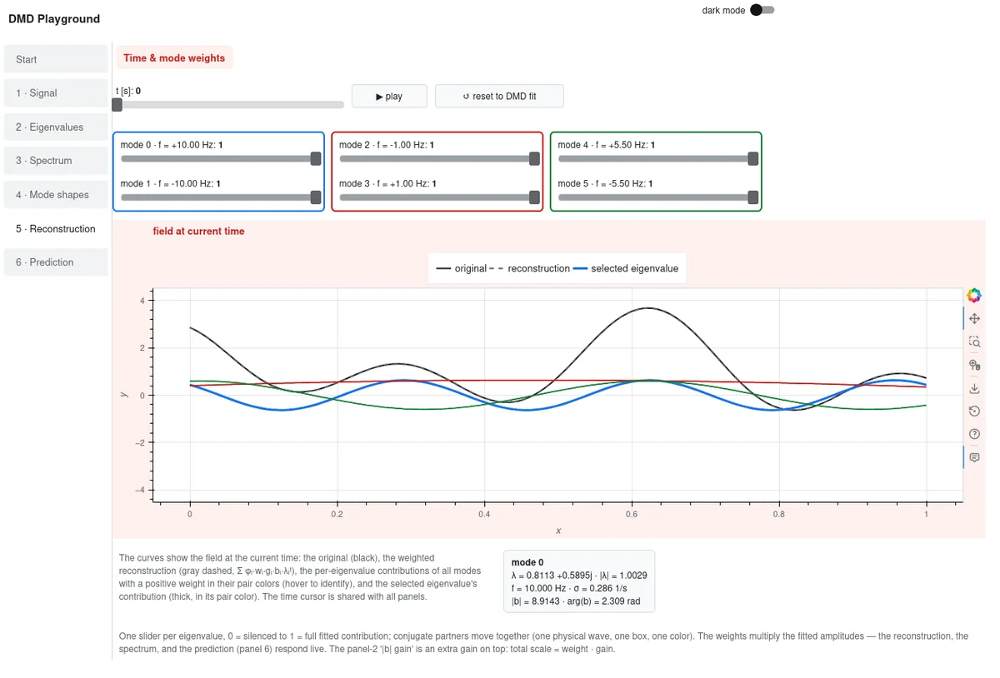
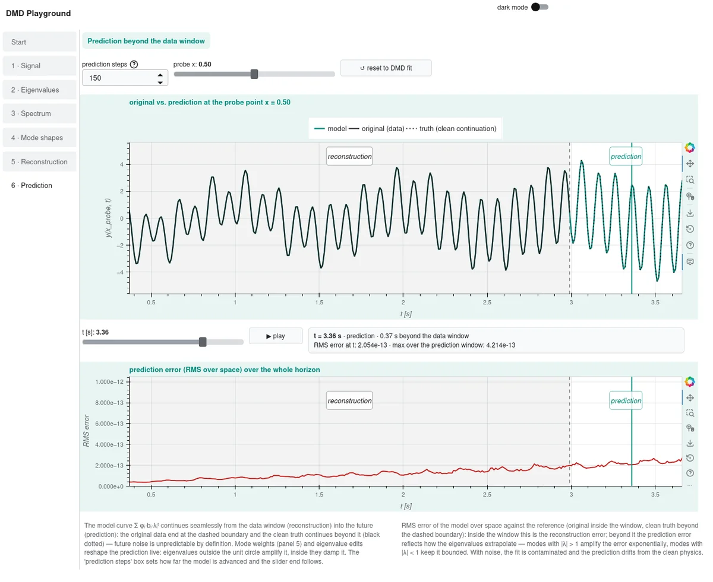

# DMD Playground — Dynamic Mode Decomposition, hands-on

**Build synthetic waves, decompose them with DMD, and interact with everything
it computes — eigenvalues you can drag, modes you can morph, predictions you
can push into the future.**

Dynamic Mode Decomposition (DMD) breaks a time series of fields into a small
set of physical modes — growing, decaying, and oscillating waves, each with
its own eigenvalue, spatial shape, and amplitude. Instead of just looking at
printed results, the playground lets you compose the signal yourself, fit DMD
with one click, and then play with every quantity it returns: drag eigenvalues
around the unit circle while the reconstruction follows live, morph standing
waves into traveling ones, blend or silence single modes with weight sliders,
and advance the model beyond the data window to watch the prediction — and
its error — grow. Developed as teaching material for the ML-CFD course at
TU Dresden; all DMD math is delegated to
[flowTorch](https://github.com/FlowModelingControl/flowtorch).

For transparency:

> **Note:** This project is vibe coded — it is developed end-to-end in an
> AI-assisted workflow (human direction and review, AI implementation) using
> [OpenCode](https://opencode.ai) with models provided by
> [ScaDS.AI](https://llm.scads.ai) (GLM-5.3-Flash for coding, alias-vision for
> GUI screenshot review); the ScaDS.AI access is provided via
> [TU Dresden](https://tu-dresden.de), where the project is developed as
> teaching material for the ML-CFD course.

## Installation

You need **Python 3.10 or newer** (tested with 3.12).

```bash
# 1 — get the code
git clone https://github.com/JanisGeise/dmdsim.git
cd dmdsim

# 2 — create the Python environment
python3 -m venv .venv
source .venv/bin/activate

# 3 - install the dependencies
pip install --upgrade pip
pip install -r requirements.txt -e .
```

## Run the GUI

Start the app from the project folder:

```bash
.venv/bin/dmdsim-app
```

A browser tab opens with the playground (the server stops itself about two
seconds after you close the tab). The Start panel recaps what DMD does in a
nutshell; from there, six step panels guide you through the method:

**Start** — the 2-minute DMD recap and buttons that jump into the steps.



**1 · Signal** — design a synthetic wave signal and run the DMD fit.



**2 · Eigenvalues** — drag the eigenvalues around the unit circle; the
reconstruction follows live.



**3 · Spectrum** — amplitudes over frequency and the growth/direction plane.



**4 · Mode shapes** — morph standing ↔ traveling waves, inspect the phase
and the space–time map.



**5 · Reconstruction** — blend each mode's contribution with weight sliders.



**6 · Prediction** — advance the fitted model beyond the data window and
watch the prediction error grow.



Every panel carries a **↺ reset** button, inline hints explain each quantity,
every parameter has a **"?" tooltip**, and a **light/dark switch** sits in the
application bar.

## Tests

```bash
.venv/bin/pytest
# with coverage
.venv/bin/pytest --cov=dmdsim
```

## License

`dmdsim` is licensed under the GNU General Public License v3.0 or later
(see `LICENSE`). The DMD computations delegate to
[flowTorch](https://github.com/FlowModelingControl/flowtorch), which is
GPL-3.0 licensed as well.

## Internal documentation

`documentation/` documents the internals for developers and is updated with every
implementation step: `architecture.md` (layers, data flow, design decisions) and
`modules.md` (module-by-module reference). The chronological step log `steps.md`
is kept locally only (untracked).

Plans, roadmap, and the status of completed steps are kept internal as well
(`PLAN.md`, untracked) — this README stays user-facing (installation, the
GUI, tests, license).
